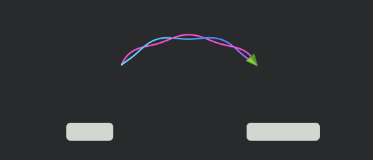
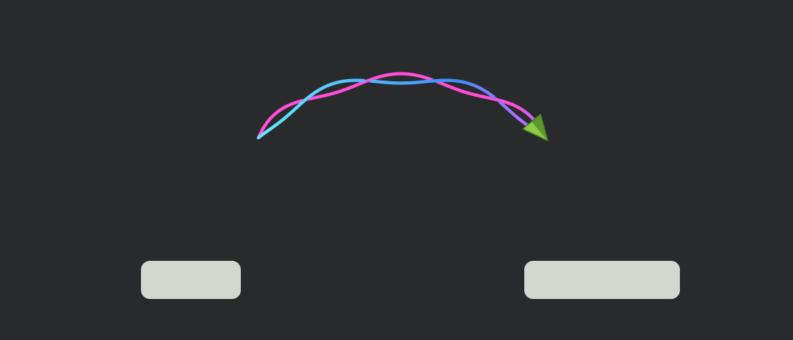
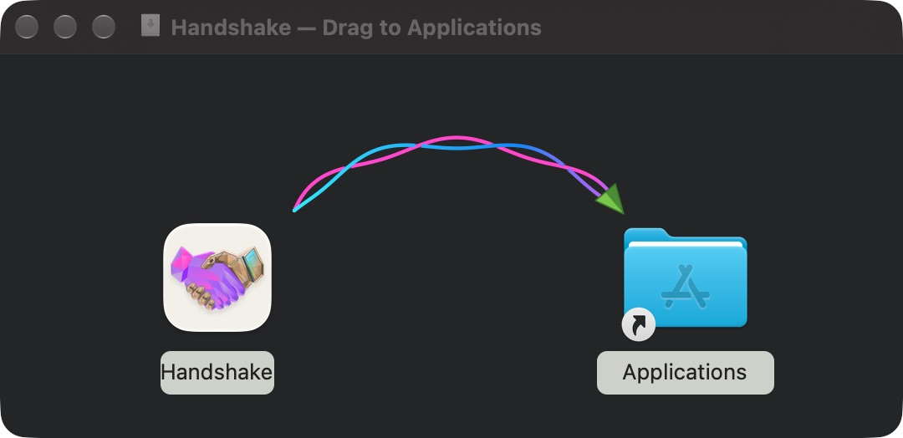

Release DMGs use the intertwined braided arrow in `installer-background.svg`.
Its two stems arc toward Applications; the
arrowhead uses two green facets and a defined edge. The charcoal background is
`#292A2B`, with light filename backplates. The TIFF contains 540 × 232 at 72 DPI
and 1080 × 464 at 144 DPI, with the same logical size, for standard and Retina
displays.

Finder treats windows with background artwork as having a fixed appearance and
renders filenames in black ([Finder background limitations](https://c-command.com/dropdmg/help/layouts)).
The artwork keeps a charcoal canvas in both appearances and uses light
backplates behind the native filename labels. The title bar follows macOS.
Icons and filenames come from Finder; they are not painted into the background.

To change the artwork and regenerate its committed TIFF:

```sh
make regenerate-dmg-artwork
make check-bundle
make build-dmg APP=out/packaging/Handshake.app DMG=out/packaging/Handshake.dmg
HANDSHAKE_SIGNING_MODE=adhoc make validate-dmg DMG=out/packaging/Handshake.dmg
```

`APP` must point to an already signed release app with its release version and
bundled license. `build-dmg` copies it into the image without changing the app.
`validate-dmg` takes an existing DMG and mounts it read-only to check its format,
contents, Finder layout, artwork, app versions, architectures, signature, and
entitlements. It does not create an app, build an image, install, or launch Handshake.
Use `VERSION=MAJOR.MINOR.PATCH` to require a specific app version.

`make dmg-tools` installs the pinned `ds-store` and `mac-alias` tools into
`out/packaging/tools`. `build-dmg.sh` creates a writable HFS+
image, writes its Finder layout using the actual mounted volume's metadata,
ejects it, and converts it to the final compressed UDZO image. The background
alias resolves by volume identity and file catalog ID, including after the
image is downloaded and mounted somewhere else. No Finder or AppleScript is
required to create the DMG. The background stays hidden; only `Handshake.app` and
the Applications shortcut are visible. Validation mounts the image at a different
path and checks that the background alias still resolves.

Generated artwork previews at standard and Retina resolutions (the same artwork
is used in both system appearances):





The two background previews contain only the artwork. Finder places the app at
`(130, 134)` and Applications at `(410, 134)`, with native filenames over the
backplate rectangles.

Mounted local 0.4.0 installer, with its native app icon and Applications alias:



The owner approved the restored intertwined background. It intentionally retains
the earlier `#292A2B` canvas and light label backplates. The release app icon
continues to use the approved Handshake artwork.

`make release` produces the optimized app candidate without debug information.
CI calls `bash .github/release/bundle-artifact.sh bundle BUILD BUNDLE` to collect the app,
library, header, and commit identifier into a build bundle. The release workflow
downloads that bundle and calls `bash .github/release/bundle-artifact.sh package VERSION BUNDLE OUTPUT`
through `with-signing.sh` to sign and notarize the app and DMG and create the release downloads.
`VERSION` must be `MAJOR.MINOR.PATCH` and match the app's marketing version.
`make check-bundle` runs the changelog extraction and mocked signing,
notarization, and credential cleanup tests, then lints the shell scripts.
Main CI creates an ad hoc signed DMG from the actual release app and
validates it. The release workflow validates the signed and notarized DMG before
uploading the release downloads. Validation defaults to Developer ID verification
and requires `APPLE_TEAM_ID`; it also checks stapled notarization tickets and
Gatekeeper acceptance. `HANDSHAKE_SIGNING_MODE=adhoc` checks the app signature without
requiring Developer ID signing, notarization, or Gatekeeper acceptance.
Bundles, staging, credentials, notarization diagnostics, installers, and archives
live in `out/packaging/`; `make clean` removes them. Release assets contain the DMG,
C ABI library archive, source archive, and checksums; no symbols archive is generated.

Local packaging inputs use `HANDSHAKE_SIGNING_MODE`, `HANDSHAKE_SIGNING_DIRECTORY`,
`HANDSHAKE_SIGNING_KEYCHAIN`, `HANDSHAKE_NOTARY_PROFILE`, and
`HANDSHAKE_NOTARY_LOG_DIR`. Each accepts the corresponding `TWINE_` name as a
legacy fallback when the new value is unset or empty. The credential wrapper
creates its own temporary keychain and notary profile for its child command.
