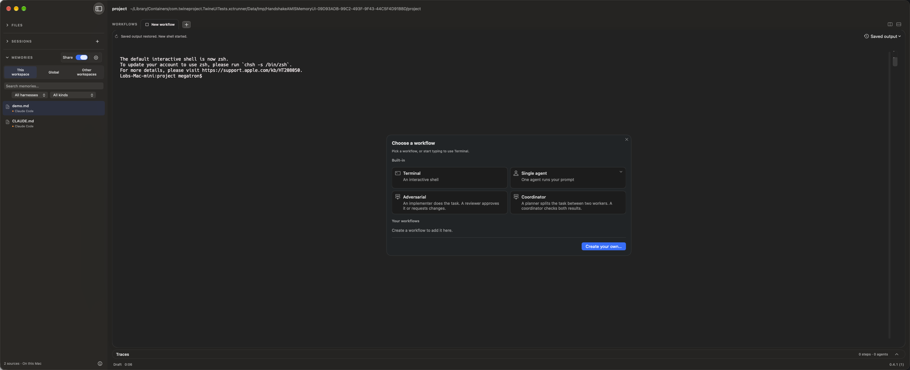

# Automatic Handshake Memories trial

This branch now runs an automatic, local AMIS 0.4 memory reconciler for Codex and
Claude Code. The interactive memory journey is
[journey-of-a-memory.html](journey-of-a-memory.html); the original Twine architecture walkthrough is
[native-memory-visual-guide.html](native-memory-visual-guide.html).

Handshake owns a canonical AMIS library, captures eligible native project memories,
appends immutable observations and consolidated views, and delivers them in native
harness formats. Fresh Handshake sessions receive native memory configuration
automatically, without a shared-catalog instruction or an import button.

New installations use `~/Library/Application Support/Handshake/memories`.
A registered legacy library at `~/Library/Application Support/Twine/memories` stays
in place unless a Handshake memory destination is already established. Its native
profiles, source identities, physical ownership bindings and sealed receipts are
preserved. Application-data migration does not clone that live library. See the
[rename compatibility inventory](../adr/0009-handshake-rename-inventory.md#cross-agent-memory-integration).
`HANDSHAKE_MEMORY_DIRECTORY` takes precedence over the legacy
`TWINE_MEMORY_DIRECTORY` input; explicit app/test roots remain isolated.

## Feature flag

Open **Settings > Feature flags** and enable **Cross-agent memory consolidation**.
This app-wide flag defaults off for new installations; the existing local trial is
explicitly enabled. The toggle saves immediately, applies to every open folder,
and persists across launches. Configuration-file users can set:

```toml
[feature_flags]
cross_agent_memory_consolidation = true
```

Turning it off hides the consolidation controls, blocks new capture/publication
requests and stops the background worker after in-flight consolidation drains.
Memories and per-project policies remain intact. Running agents continue, and
saved Codex sessions can resume from their already-bound native homes without
registering or synchronizing memory while the flag is off. The ordinary native
memory browser remains available.

The settings editor and feature toggles share versioned conflict protection. Raw
configuration edits must be saved or discarded before a toggle can change the
file. A failed apply remains retryable, and concurrent external edits are preserved.

## Try the small workspace

The trial app is installed at `~/Applications/Handshake.app`; the current source
version is **Handshake 0.4.1**.
Use `~/workspaces/twine-memory-small/Open in Handshake.command`, or open the app
normally. The small workspace keeps its existing folder path and memory UUID.
Its application state is carried from the earlier isolated trial into
`~/Library/Application Support/Handshake`, using `handshake.db`; the source is
retained. The existing three native memory views and generated Codex startup
memory remain in their original managed profiles.

Use the **Share** switch and adjacent gear to the right of **Memories**. The
selected compact group remains available when the section is collapsed. The gear
opens a native **Memory settings** popover with status, collapsible project memory
previews and storage profiles. **Check now** is optional; **Refresh sources** keeps
the ordinary memory browser’s existing rescan action available. Start a fresh Codex or Claude
conversation and ask an ordinary project question. Existing conversations can
retain earlier startup context; Codex's first native memory pass and quota guard
can delay startup availability in a new project.

The retired large playground, obsolete trial state stores and 1,019 injected
Claude memory files remain removed. Earlier Twine application bundles are removed
after the rebuilt app is verified. Unrelated projects and ordinary conversation
history are retained.

## Compact sharing controls (2026-10-26)

The selected design is option 5 in
[memory-sharing-minimal-options.html](memory-sharing-minimal-options.html): a
labeled system switch and SF Symbols gear, grouped on the right of the existing
Memories header. They replace the separate Handshake text button. Disclosure,
sharing policy and settings have separate controls and accessibility names.
The app-wide feature flag still hides the group when disabled.

The main control uses agent-neutral copy. Settings render agent names and native
paths from a profile collection. The current transport's `claudePath` and
`codexPath` are mapped at one presentation boundary; the two existing adapters,
AMIS contract, storage, quota controls and delivery behavior are unchanged. This
prepares the layout for additional profiles without claiming additional adapter
support today.

The native popover replaces the large modal sheet. Project-memory and storage
lists are collapsed initially, repeated Markdown headings are omitted only from
previews, and native loading/scheduling details live under storage. Pausing in the
header retains the project's saved memories. There is one project sharing toggle.

Apple references: [Toggles](https://developer.apple.com/design/human-interface-guidelines/toggles),
[Popovers](https://developer.apple.com/design/human-interface-guidelines/popovers),
and [Layout](https://developer.apple.com/design/human-interface-guidelines/layout).
These guide system controls, clear labeling, transient presentation and grouped
related actions; this is not a claim of Apple certification.

## Header-control validation (2026-10-26)

- `make fmt` and `make check` passed for the library and app; the final app check
  passes 394 tests. Library coverage remains 588 core and 49 bridge tests.
- Eight isolated desktop UX cases pass: feature flag gating/persistence, native
  bidirectional updates and relaunch, active-profile deferral, pause/resume, storage
  access and Escape at 200% zoom, ordinary memory-browser refresh, visible failed
  policy saves, and independent header controls with persisted project policy.
- The selected HTML comparison passes 180 option/state/appearance/viewport
  combinations. Swift and Rust reviews completed with findings addressed.
- Native UX testing caught popover height compression and unreliable disclosure
  interaction under zoom. The popover now reports its bounded intrinsic height,
  uses the app’s accessible full-row disclosure buttons, and handles Escape only
  for the popover and its owning window. Failed actions appear at the top.
- These checks make zero native model calls. The earlier two-fact recall evidence
  is retained; no additional native recall questions were sent for this UI change.



Logs and original screenshots: `out/validation/memory-controls/`.

## Native integration

- **Claude:** an invocation-only `--settings` value selects `autoMemoryDirectory`
  at `~/.claude/projects/twine-<project UUID>/memory/`. It merges with Handshake's existing
  observer hooks. User authentication, configuration and session-history locations
  stay in their normal locations. The native `MEMORY.md` links to Handshake's native
  project index and topic files.
- **Codex:** a per-project `CODEX_HOME` lives under
  `memories/projects/<project UUID>/native/codex`. Credentials, configuration and
  supported user guidance are reused; memory and session state remain project
  scoped. Inputs go to `memories/extensions/ad_hoc/notes/`. Codex owns its generated
  `MEMORY.md`, `memory_summary.md`, extraction stores and consolidation scheduling.
- **Capture:** native Claude topics, Codex ad-hoc notes and managed native Codex
  registry entries. Entries from the global Codex registry require an exact native
  cwd binding. Arbitrary chat transcripts and unrelated project memories are not
  automatically shared.
- **Feedback:** owned unchanged files are recognized by local publication state.
  Generated Codex registry snapshots retain known delivered ancestry and are
  exported to Claude without being fed into Codex's own input notes again.

Native session leases prevent background replacement while that harness is
running. Delivery into the other idle harness continues. The worker retries after
the active session ends; an existing conversation's startup context is not hot
replaced. Standalone CLI sessions use their ordinary profile unless launched
through Handshake.

## AMIS and durable storage

Schemas are vendored unchanged from AMIS commit
`9723ef4f33a3aadb194f8c6db14291102ddc182a`; see
[UPSTREAM.md](../../handshake-core/contracts/amis-0.4.0/UPSTREAM.md).

Each project keeps `library.amis.json`, local receiver bindings, exact source
snapshots, native before/after blobs, sealed publication plans, local policy
transactions and byte-verification receipts. AMIS metadata cannot grant local
write authorization. Unknown receiver identities, bad integrity, duplicate JSON
keys, conflicting heads, unsupported time bounds and unsafe native paths hold
reconciliation rather than overwriting memory.

Consolidation is deterministic: exact text can share a derived view, with separate
source identities retained. Similar or contradictory claims stay separate. Handshake
makes no model calls for this pass. Native memory generation uses the harness's
normal quota controls; this machine's Codex threshold remains 10%.

Source disappearance does not erase history. Explicit withdrawal appends a
withdrawal revision and corrects owned native copies, including original managed
source notes. Generated native summaries can retain an old claim until their
harness refreshes them; receipts claim native-byte availability, not guaranteed
forgetting or recall.

## Handshake port validation (2026-10-25)

The feature branch includes renamed main at `862c5b8`. `make fmt` and `make check`
pass: 581 core tests, 49 bridge tests and 383 app unit tests. Four renamed desktop
memory UX cases pass, and both actual native harnesses answer the ordinary recall
questions from their existing managed memory profiles. Screenshots were inspected.
Codex's weekly meter was 2% before and after these two short questions.

The six existing immutable AMIS revisions are byte-for-byte preserved. New
compatibility tests cover memory override precedence, keeping established native
bindings in place, and avoiding a copied second memory library during app-data
adoption. Source: `out/validation/handshake-port/validation.json`; build/check logs,
UX results and install/removal receipts live beside that report.

## Validation

- Full library/app format, lint, build and unit checks are recorded in
  `out/validation/memory-journey/check-final.log`. One unrelated model-listing
  process fixture missed its 300 ms startup window during a repeated run; the
  complete rerun passed. The failed-run log is retained as
  `out/validation/memory-journey/check-process-fixture-failure.log`.
- Focused tests cover bidirectional capture, native updates, duplicate prevention,
  malformed documents, project isolation, receiver-binding recovery, crash windows,
  independent index edits, per-harness leases and grouped withdrawal retry.
- The pinned AMIS reference checker validates actual generated bundles, plans,
  capabilities and receipts through the C ABI. Evidence:
  `out/validation/twine-amis/ffi-validation.json`.
- Four real macOS UI tests pass: automatic two-way sharing with a native edit,
  native byte verification and relaunch; pause/reopen/resume; active-session
  deferral with automatic retry; and readable storage details with reachable actions
  at 200% zoom. Evidence: `out/validation/memory-journey/fixture-ux-final.log`.
- Two small seeded native facts were recalled through ordinary questions in fresh
  agents launched from the actual Handshake menus. Codex answered `maple-417` from the
  Claude-origin memory; Claude answered `green` from the Codex-origin memory.
  Neither prompt nor workspace contained the values. Screenshots and recorded
  responses were checked. Evidence: `out/validation/memory-journey/ux-validation.json`.
- Screenshot review caught an earlier case mislabeled as Claude that actually
  launched Codex. That case was excluded; selection is now scoped and persisted
  harness identity is checked before sending. A Claude first-run trust dialog also
  consumed one attempted input; no model question was delivered in that attempt.
  The corrected Claude-only run passed in 37.620 seconds. In total this renewed
  test sent two Codex questions and one Claude question. Codex's rounded weekly
  meter remained at 88%; Claude usage was not measured.
- UX fixes: normal native lease deferral no longer shows a red Sync now failure;
  the storage disclosure uses a plain accessible button that works at 200% zoom.
- The actual small trial's AMIS library, 11 sealed plans/capability documents and
  11 receipts pass the pinned reference validator. Evidence:
  `out/validation/memory-journey/amis-validation.json`.
- The old workspace and injected native memories were removed with zero model
  calls. Evidence: `out/validation/memory-journey/cleanup.json`.
- The new journey guide passes 144 WebKit states at 375, 768 and 1160 px, including
  both directions, active-session and revision states, plus navigation. Evidence:
  `out/validation/memory-journey/html-validation.json`.
- Fresh native Codex consolidated and recalled the Claude-origin fictional account
  code. Weekly usage was 88% before and after the tiny run. Evidence:
  `out/validation/twine-amis/native-e2e.json` (Codex results).
- Fresh native Claude recalled the Codex-origin fictional deployment lane and
  performed two reads from its native memory directory. Evidence:
  `out/validation/twine-amis/claude-recall-fixed.json`.
- The HTML walkthrough passes 36 WebKit states at 375, 768 and 1440 px, plus its
  navigation controls. Evidence: `out/validation/native-memory-visual/validation.json`.

These are local trial results. Schema/reference checks do not constitute independent
AMIS synchronizer certification or broad compatibility across future harness versions.

The older explicit native importer remains in core for compatibility; the primary
app flow now uses the automatic Handshake AMIS memory implementation.

## Maintainer review (2026-10-26)

Aravind Nidadavolu reviewed PR #199 and authorized his DCO sign-off for the
branch’s prior commits, with merge gated on passing CI. The remediation commit
records that authorization without rewriting the feature branch’s history.
